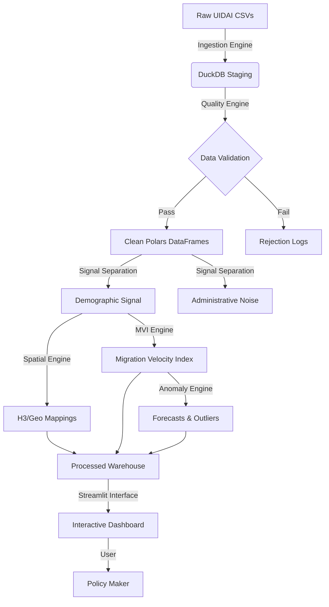

# System Architecture: Aadhaar Sanket
### Technical Design & Infrastructure Documentation

## 1. System Overview
**Aadhaar Sanket** is a deterministic, privacy-preserving demographic intelligence platform. It is designed to extract "truth" from high-volume, noisy administrative datasets (UIDAI).

The core design philosophy is **"Signal from Noise"**:
- **Deterministic Processing**: The same input data will always produce the exact same Migration Velocity Index (MVI), guaranteeing auditability for government use.
- **Explainable AI**: No "black box" neural networks are used for core metrics. Forecasting uses decomposable models (Prophet/LightGBM) where every decision boundary is transparent.
- **Privacy First**: The system operates exclusively on **aggregated** counts (e.g., "Males age 20-30 in District X"). No PII ever enters the ingestion pipeline.

## 2. End-to-End Architecture Flow

## 3. Directory Structure & Component Logic

### `src/engines/` (Core Logic)
The backend is modularized into isolated "engines". Each file is responsible for a single stage of the pipeline.

- **`ingestion.py`**: Handles raw I/O. Uses **DuckDB** for lazy loading of massive CSVs. Enforces schema types at read time to prevent "object" dtype pollution.
- **`quality.py`**: The integrity firewall. Contains **Great Expectations** suites and custom Pydantic validators. Rejects entire batches if statistical properties deviate from expected bounds (e.g., >5% nulls in district columns).
- **`signal_separation.py`**: The critical business logic. Distinguishes between "Organic Migration" (e.g., Address Change) and "Administrative Noise" (e.g., Biometric Update, Mobile Number Linkage).
- **`mvi.py`**: Computes the **Migration Velocity Index**. This engine aggregates normalized inflows/outflows over sliding time windows to produce a scalar velocity metric for every geographic unit.
- **`spatial.py`**: Manages geospatial relationships. Maps administrative boundaries (State > District > Sub-District) to **H3 Hexagons** for uniform spatial analysis.
- **`anomaly.py`**: Intelligence layer. Uses **Prophet** for time-series forecasting and statistical outlier detection (Z-scores) to flag sudden demographic spikes.

### `src/utils/` (Helpers)
- **`config.py`**: Central configuration for paths, constants, and hyperparameters. **NO** hardcoded paths are allowed elsewhere.

### `frontend/` (Visualization)
- **`app.py`**: Main entry point. Handles session state initialization and global sidebar navigation.
- **`pages/1_migration_map.py`**: The "War Room" view. Renders PyDeck visualization of the MVI. heavily uses `st.cache_data` for performance.
- **`pages/2_spatial_stress.py`**: Heatmap analysis showing infrastructure pressure points.
- **`pages/3_forecasts.py`**: Predictive analytics view showing "What-If" scenarios.
- **`pages/4_policy_insights.py`**: Text-heavy, actionable executive summary generation.

### `data/` & `processed/`
- **`data/`**: **READ-ONLY**. Raw UIDAI CSVs live here. GITIGNORED (mostly).
- **`processed/`**: **CACHE/WRITE**. Intermediate Parquet files optimized for Streamlit read speeds.

## 4. Backend Pipelines (Deep Dive)

### Data Ingestion Pipeline
The pipeline relies on **DuckDB** as a high-performance staging area. Instead of loading everything into RAM (Pandas), we use DuckDB to perform initial SQL-based filtering and casting on-disk, converting results to **Polars** DataFrames only when the working set is manageable.

### Signal vs. Noise Separation
This is the most complex logic. Raw data contains "Updates". An update can be:
1. **Migration Signal**: Address update (High value).
2. **Growth Signal**: New Enrolment (Medium value).
3. **Noise**: Mobile/Email update, Biometric refresh (Zero migration value).

The `signal_separation` engine applies weighted filters to strip out Type 3, ensuring the MVI reflects *people moving*, not *people fixing typos*.

### Migration Velocity Index (MVI) Computation
$$MVI = \frac{(Inflow_{norm} - Outflow_{norm})}{\sigma_{historical}} \times \alpha_t$$
The MVI is not a raw count. It is a **standardized velocity** representing deviation from the norm, weighted by recency ($\alpha_t$). This allows small towns with sudden influxes to flag correctly alongside large metros.

## 5. Frontend Architecture
Streamlit is used in **Multi-Page App (MPA)** mode.
- **State Management**: `st.session_state` is used to persist filtered datasets between page navigations.
- **Caching**: Aggressive use of `st.cache_data` ensures that heavy tasks (MVI computation) happen only once per session or data update.
- **Components**: We use `pydeck` for 3D geospatial rendering, which is significantly faster than Folium for large coordinate sets.

## 6. Data Flow & Contracts
1. **Contract 1 (Ingestion)**: All input columns must match `data_schema.json`. Variance throws `SchemaError`.
2. **Contract 2 (Processing)**: All output DataFrames must be **Polars**. Pandas is used ONLY for plotting compatibility at the very last mile.
3. **Contract 3 (Types)**: Geocodes are always strings (to preserve leading zeros). Counts are always Integers (never floats).

## 7. Code Quality & Maintenance
- **Pure Functions**: Backend processing functions are statistically "pure" — they do not modify global state.
- **Type Hinting**: strict `mypy` compliance is encouraged.
- **Modularity**: New analysis modules should be added as new files in `src/engines/` and imported into `run_pipeline.py`.

## 8. Extension Guide
- **Adding New Logic**: Create `src/engines/new_metric.py`. Register it in `run_pipeline.py`.
- **Adding New Pages**: Create `frontend/pages/5_new_view.py`. It automatically appears in the sidebar.
- **Updating Data**: Drop new CSVs into `data/`. The system detects timestamp changes and invalidates the `processed/` cache automatically.
