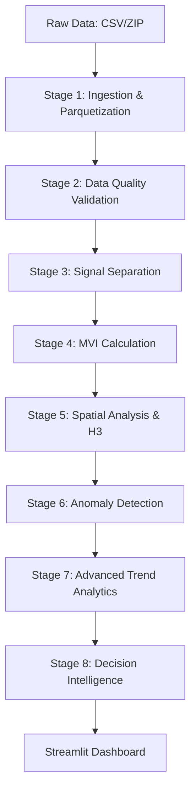

# Project Aadhaar Sanket: Architectural Deep Dive

## 1. System Overview
**Project Aadhaar Sanket** is a state-of-the-art Demographic Intelligence System designed to transform raw Aadhaar update and enrolment data into actionable migration insights. Unlike traditional analytics, it focuses on **Signal-to-Noise Separation**—distinguishing genuine population movement (signals) from mandatory administrative updates (noise).

The system is built on a "Hardened Analytics" philosophy:
- **Deterministic**: No black-box LLMs in the core data path.
- **Explainable**: Every index (like MVI) has a clear mathematical derivation.
- **Privacy-Preserving**: Operates on aggregated, non-personally identifiable information (PII).

---

## 2. Peak Technology Stack
We use a "Modern Data Stack" optimized for high-performance local processing:

| Technology | Purpose | Why This Choice? |
| :--- | :--- | :--- |
| **Polars** | Core Data Processing | Lightning-fast vectorized operations (written in Rust); significantly faster than Pandas for large CSV/Parquet files. |
| **DuckDB** | In-process Analytical SQL | Allows complex relational queries directly on Parquet files without a heavy database server. |
| **H3 (Uber)** | Hexagonal Geospatial Indexing | Enables efficient spatial clustering and multi-resolution analysis (resolutions 4/5/6). |
| **GeoPandas** | Spatial Vector Data | Standard for handling shapefiles and geographic geometries in Python. |
| **Streamlit** | Command-and-Control UI | Rapid deployment of high-fidelity, interactive dashboards. |
| **PyDeck** | Layered Map Visualizations | Powered by Deck.gl, it handles millions of points/hexagons with GPU acceleration. |
| **Great Expectations**| Data Quality Hardening | Automated validation of schema, nulls, and statistical drifts. |

---

## 3. End-to-End Workflow Mechanism

The system orchestrates an 8-stage pipeline in `run_pipeline.py`:



### Stage 1: Ingestion Engine (`ingestion.py`)
- **Process**: Normalizes heterogeneous CSV headers into a standard schema.
- **Mechanism**: Converts CSVs to **Apache Parquet**, reducing file size by ~80% and enabling sub-second query speeds.

### Stage 3: Signal Separation Engine (`signal_separation.py`)
This is the intellectual core. It calculates **Organic Migration Signals** by weighting updates:
- **Demographic (Adult)**: Weight **1.0** (Strong signal: address change).
- **Demographic (Youth)**: Weight **0.6** (Moderate signal: family move).
- **Biometric (Adult)**: Weight **0.3** (Weak signal: likely re-enrollment).
- **Biometric (Child)**: Weight **0.1** (Noise: mandatory updates at ages 5/15).

### Stage 4: Migration Velocity Index (MVI) (`mvi.py`)
The MVI is our primary metric, calculated as:
$$\text{MVI} = \left( \frac{\text{Signal-Adjusted Updates}}{\text{Total Enrolment Population Base}} \right) \times 1000$$

**Interpretation Bands:**
- **Stable (< 5)**: Minimal demographic churn.
- **Moderate (5-15)**: Normal movement.
- **Elevated (15-30)**: Significant stress.
- **High Pressure (> 30)**: Intense demographic volatility.

---

## 4. Engine Mechanisms & Logic

### A. Spatial Intelligence (`spatial.py`)
- **H3 Indexing**: Maps pincodes to hexagonal grids. This solves the "Modifiable Areal Unit Problem" (MAUP) by using uniform shapes.
- **Hotspot Detection**: Uses spatial autocorrelation to identify clusters of "High Pressure" MVI across neighboring districts.

### B. Anomaly Engine (`anomaly.py`)
- **Statistical Detection**: Uses a **Rolling Z-Score** calculated as $Z = (x - \mu) / \sigma$ over a 30-day baseline window.
- **Classification**: Anomalies are tagged as:
    - **SPIKE/DROP**: Sudden deviation from historical mean.
    - **STRUCTURAL**: Sustained deviation (> 30% anomaly frequency).
    - **TRANSIENT**: Isolated events (external shocks).
- **Severity Matrix**: 
    - CRITICAL: $|Z| > 4$
    - HIGH: $|Z| > 3$
    - MEDIUM: $|Z| > 2$

### C. Trend Typology Engine (`trend_typology.py`)
Classifies regions into five behavior archetypes using linear regression and variance analysis:
1. **Persistent Inflow**: High positive slope ($>2.0$) and low variance ($<2.0$). Indicates steady, predictable growth.
2. **Emerging Inflow**: High slope with positive **Acceleration** (Recent Slope - Historical Slope).
3. **Volatile**: High variance ($>10.0$). Indicates unstable or erratic migration patterns.
4. **Reversal**: Negative slope ($<-0.5$) after a period of sustained activity.
5. **Stable**: Low slope and low variance. Minimal demographic change.

### D. Decision Intelligence (`policy_mapper.py` & `insight_generator.py`)
- **Policy Mapping**: Maps MVI and Trend types to specific government interventions (e.g., "Augment Water Infrastructure" for Persistent Inflow areas).
- **Confidence Scoring**: Adjusts "Trust Scores" based on the **Population Base**. Higher population = Higher MVI confidence.

---

## 5. Directory Structure Explainer
```text
├── data/                  # Raw UIDAI datasets
├── processed/             # Parquet files & Pipeline reports
├── run_pipeline.py        # Central Orchestrator
├── src/
│   ├── engines/           # Core Mathematical Logic
│   │   ├── mvi.py         # MVI Math & Logic
│   │   ├── signal_sep.py  # Noise/Signal separation
│   │   └── ...            # Other analytical modules
│   ├── ai/                # Helper AI logic (non-core)
│   └── config.py          # Global parameters & Weights
└── frontend/              # Streamlit Application
```
